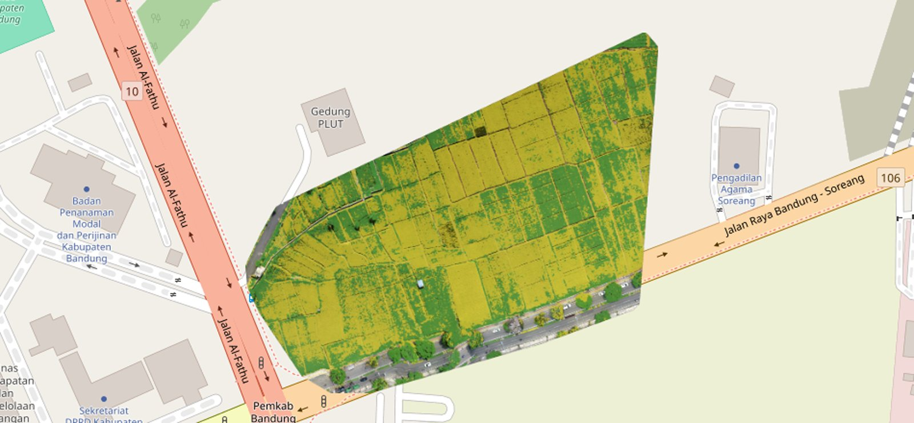

<p align="center">
  
</p>

<div align="center">

[](package.json)
[](package.json)
[](tsconfig.json)
[](tailwind.config.ts)
[](components/map-view.tsx)
[](#tentang)

# Rice Harvest Web

### Antarmuka web untuk membaca kesiapan panen padi dari foto drone.

**Peta dulu, angka kemudian.** Hasil klasifikasi langsung ditumpuk di atas peta lahan, lengkap dengan verdict dan file GeoTIFF yang bisa diunduh.

**[Backend](https://github.com/ryanmhildan/rice_classification_api) · [Kontrak API](https://github.com/ryanmhildan/rice_classification_api/blob/main/BACKEND_API.md)**

[Tampilan](#tampilan) · [Menjalankan](#menjalankan) · [Halaman](#halaman) · [Struktur](#struktur) · [FAQ](#faq)

<code>npm install --legacy-peer-deps && npm run dev</code>

</div>

---

## Tampilan

### Dari foto ke peta

Pengguna mengunggah foto drone, backend menjahitnya menjadi orthophoto dan mengklasifikasikan setiap piksel padi. Halaman detail menampilkan hasilnya di atas OpenStreetMap dengan auto-zoom ke batas lahan.

| **Upload** | **Detail hasil** |
|:--|:--|
| <a href="docs/screenshots/upload.png"></a> | <a href="docs/screenshots/hasil-peta.png"></a> |
| Dua mode: foto drone mentah (stitching lalu klasifikasi) atau hasil yang sudah diproses di luar sistem. | Layer orthophoto dan klasifikasi bisa dinyalakan terpisah, opasitasnya diatur dengan slider. |

### Riwayat

| **Semua hasil** | **Per lahan** |
|:--|:--|
| <a href="docs/screenshots/hasil-list.png"></a> | <a href="docs/screenshots/riwayat.png"></a> |
| Setiap kartu membuka halaman detail dengan peta. | Diambil dari database SQLite di backend, dikelompokkan per sawah. |

### Beranda dan status

| **Beranda** | **Status sistem** |
|:--|:--|
| <a href="docs/screenshots/beranda.png"></a> | <a href="docs/screenshots/status.png"></a> |

Klik gambar mana pun untuk melihat ukuran penuh.

## Menjalankan

Sistem terdiri dari tiga proses lokal. Frontend ini adalah yang terakhir dinyalakan.

```
Next.js :3001  ->  FastAPI :8000  ->  NodeODM (Docker) :3000
  repo ini          pemrosesan citra     stitching orthophoto
```

### Prasyarat

- Node.js 20 atau lebih baru (diuji di 22.22)
- Backend [rice_classification_api](https://github.com/ryanmhildan/rice_classification_api) aktif di port 8000

### Instalasi

```bash
git clone https://github.com/ryanmhildan/rice-harvest-web.git
cd rice-harvest-web
npm install --legacy-peer-deps
```

### Konfigurasi

Buat file `.env.local` di root repo:

```
NEXT_PUBLIC_API_URL=http://localhost:8000
```

### Development

```bash
npm run dev
```

Buka http://localhost:3001, lalu cek http://localhost:3001/status. Kedua kartu harus berstatus aktif.

### Production

```bash
npm run build
npm start
```

## Halaman

| Path | Isi |
|------|-----|
| `/` | Beranda dan status singkat |
| `/upload` | Upload foto drone atau hasil manual |
| `/jobs/[jobId]` | Progress stitching, polling tiap 5 detik |
| `/results` | Semua hasil klasifikasi |
| `/results/[timestamp]` | Peta, statistik, dan unduhan untuk satu hasil |
| `/riwayat` | Riwayat deteksi per lahan |
| `/status` | Monitoring backend dan NodeODM |

## Struktur

```
app/            halaman (App Router)
components/     peta, dropzone, panel statistik, banner verdict
lib/api.ts      pemanggilan endpoint backend
lib/types.ts    tipe response, mengikuti BACKEND_API.md
lib/utils.ts    format angka dan tanggal
docs/           screenshot README
```

Kalau endpoint backend berubah, `lib/types.ts` dan `lib/api.ts` ikut disesuaikan dalam commit yang sama.

## FAQ

**Apakah frontend ini memproses gambar?**
Tidak. Semua stitching dan klasifikasi ada di backend. Frontend hanya mengunggah, memantau, dan menampilkan.

**Butuh internet?**
Tidak untuk pemrosesan. Koneksi hanya dipakai untuk memuat tile OpenStreetMap di latar peta. Tanpa internet, layer orthophoto dan klasifikasi tetap tampil.

**Kenapa peta dimuat dengan `dynamic()`?**
Leaflet butuh objek `window` saat di-import, sedangkan Next.js merender halaman di server lebih dulu. `dynamic(..., { ssr: false })` membuat komponen peta hanya dirender di browser.

**Muncul CORS error di console.**
Origin frontend belum diizinkan. Tambahkan origin tersebut di `allow_origins` pada `api.py` di repo backend.

**Port 3001 sudah dipakai.**
Jalankan `npm run dev -- -p 3002`, lalu tambahkan `http://localhost:3002` ke `allow_origins` di backend.

<hr>

<p align="center"><em>Sistem ini membaca warna kanopi, bukan kadar air gabah.<br>
Hasilnya alat bantu keputusan, bukan pengganti petani yang turun ke sawah.</em></p>

<hr>

## Tentang

Bagian dari skripsi *Deteksi dan Pemetaan Kesiapan Panen Padi Menggunakan Citra Drone Berbasis Edge Computing dan Sistem Informasi Geografis (SIG)*, Teknik Informatika UNIKOM 2026, oleh Ryan Muhammad Hildan.

## Lisensi

Dibuat untuk keperluan skripsi. Silakan gunakan sebagai referensi akademis dengan mencantumkan sumber.
