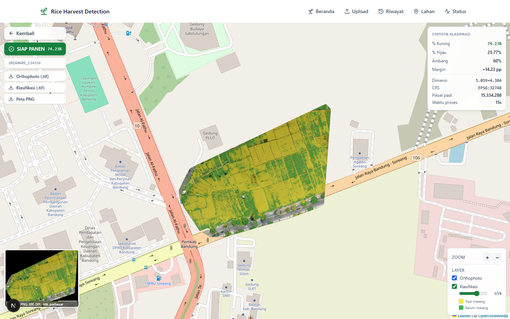
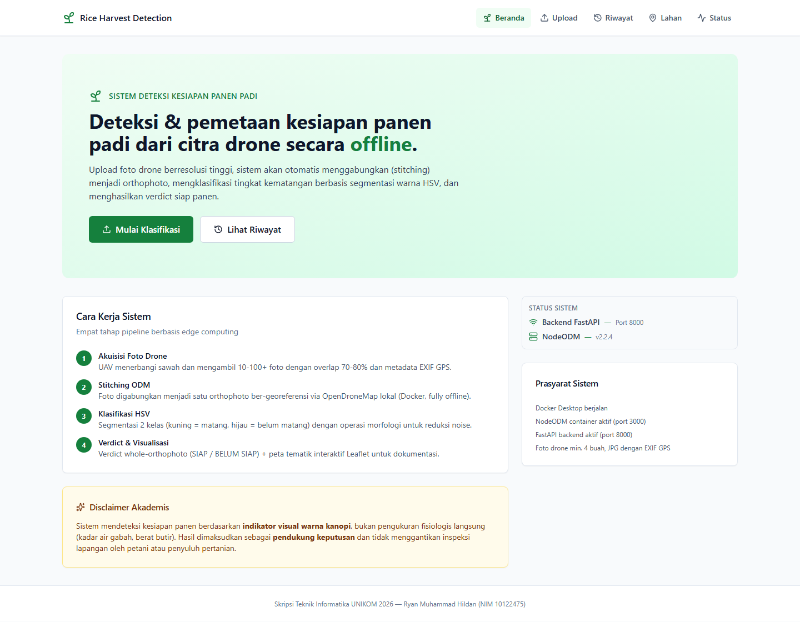
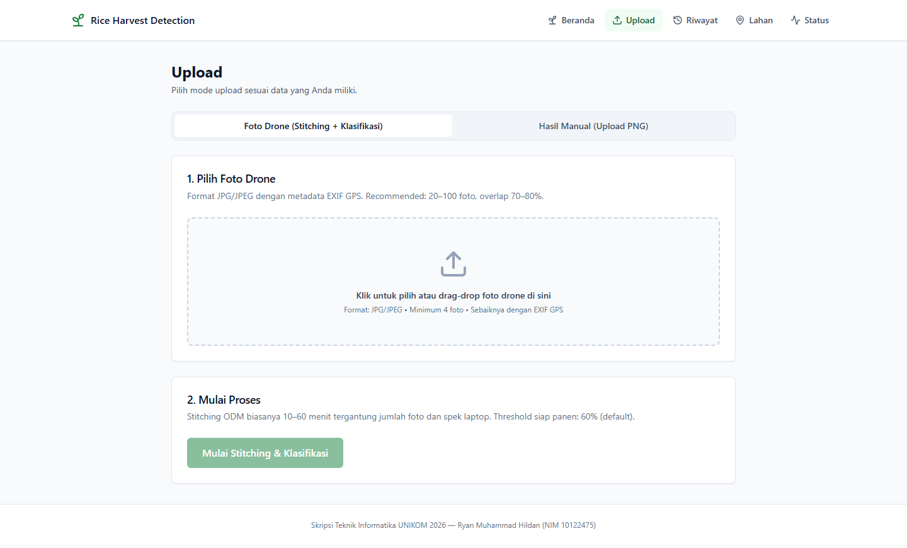
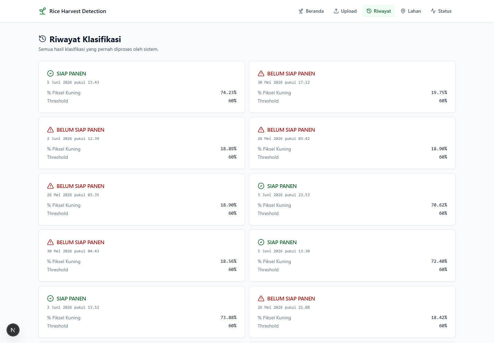
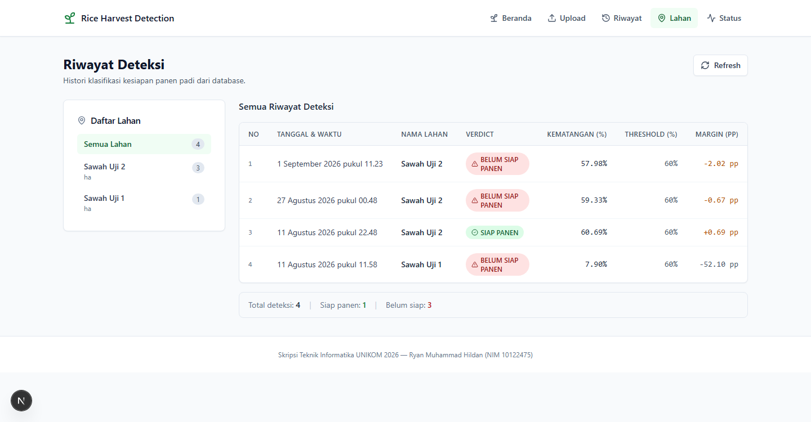
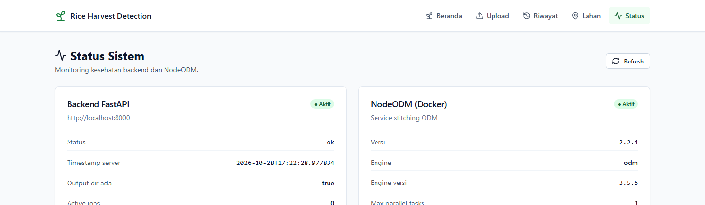

# Rice Harvest Web

Antarmuka web untuk sistem deteksi kesiapan panen padi dari citra drone. Pengguna mengunggah foto drone, memantau proses stitching, lalu melihat hasil klasifikasi kematangan di atas peta interaktif.

Repo ini hanya berisi frontend. Seluruh pemrosesan citra (stitching dan segmentasi HSV) dijalankan oleh backend di repo [rice_classification_api](https://github.com/ryanmhildan/rice_classification_api).



Dibuat sebagai bagian dari skripsi *Deteksi dan Pemetaan Kesiapan Panen Padi Menggunakan Citra Drone Berbasis Edge Computing dan Sistem Informasi Geografis (SIG)*, Teknik Informatika UNIKOM 2026.

## Arsitektur

Sistem berjalan sepenuhnya offline di satu laptop (Ground Control Station). Tiga proses berkomunikasi lewat HTTP di localhost:

```
Next.js (3001)  --->  FastAPI (8000)  --->  NodeODM / Docker (3000)
   repo ini            pemrosesan citra       stitching orthophoto
```

Frontend tidak pernah memanggil NodeODM secara langsung. Semua data diambil dari backend.

## Tampilan

### Beranda

Ringkasan alur kerja sistem dan indikator status backend serta NodeODM.



### Upload

Dua mode: unggah foto drone mentah (stitching lalu klasifikasi) atau unggah hasil PNG manual.



### Detail hasil

Orthophoto dan layer klasifikasi ditampilkan di Leaflet dengan auto-zoom ke batas lahan. Opasitas layer klasifikasi bisa diatur, dan file GeoTIFF maupun PNG bisa diunduh dari panel kiri.


### Riwayat klasifikasi



### Riwayat per lahan

Data diambil dari database SQLite di backend, dikelompokkan berdasarkan lahan.



### Status sistem



## Menjalankan

Prasyarat:

- Node.js 20 atau lebih baru (diuji di 22.22)
- Backend [rice_classification_api](https://github.com/ryanmhildan/rice_classification_api) sudah berjalan di port 8000

```bash
git clone https://github.com/ryanmhildan/rice-harvest-web.git
cd rice-harvest-web
npm install --legacy-peer-deps
```

Buat file `.env.local`:

```
NEXT_PUBLIC_API_URL=http://localhost:8000
```

Lalu jalankan:

```bash
npm run dev
```

Buka http://localhost:3001. Untuk mode production gunakan `npm run build` lalu `npm start` (tetap di port 3001).

Urutan start yang benar adalah NodeODM, backend, baru frontend. Kalau frontend dinyalakan lebih dulu, halaman status akan menampilkan backend sebagai tidak aktif sampai backend hidup.

## Halaman

| Path | Isi |
|---|---|
| `/` | Beranda dan status sistem |
| `/upload` | Upload foto drone atau hasil manual |
| `/jobs/[jobId]` | Progress stitching (polling tiap 5 detik) |
| `/results` | Daftar semua hasil klasifikasi |
| `/results/[timestamp]` | Peta dan statistik satu hasil |
| `/riwayat` | Riwayat deteksi per lahan |
| `/status` | Monitoring backend dan NodeODM |

## Stack

- Next.js 15 (App Router), React 19, TypeScript
- Tailwind CSS 3
- Leaflet + react-leaflet, proj4 untuk konversi koordinat
- lucide-react untuk ikon

Komponen peta dimuat dengan `next/dynamic` dan `ssr: false` karena Leaflet membutuhkan objek `window`.

## Struktur

```
app/            halaman (App Router)
components/     komponen UI: peta, dropzone, panel statistik, dll
lib/api.ts      client untuk endpoint backend
lib/types.ts    tipe response, disamakan dengan BACKEND_API.md di repo backend
lib/utils.ts    helper format angka dan tanggal
docs/           screenshot untuk README
```

Kalau ada perubahan endpoint di backend, `lib/types.ts` dan `lib/api.ts` perlu disesuaikan bersamaan dengan `BACKEND_API.md`.

## Troubleshooting

| Masalah | Penyebab | Solusi |
|---|---|---|
| CORS error di console | Origin belum diizinkan backend | Tambahkan origin di `allow_origins` pada `api.py` |
| `window is not defined` | Komponen Leaflet dirender di server | Import dengan `dynamic(..., { ssr: false })` |
| `npm install` gagal karena peer deps | Konflik versi React 19 | Gunakan `--legacy-peer-deps` |
| Port 3001 terpakai | Proses lain | `npm run dev -- -p 3002`, lalu tambahkan origin baru di backend |

## Lisensi

Dibuat untuk keperluan skripsi. Silakan gunakan sebagai referensi akademis.
